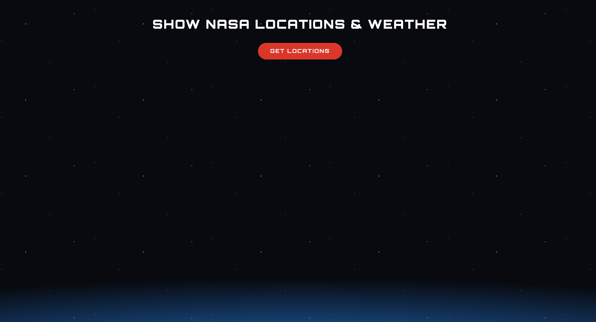
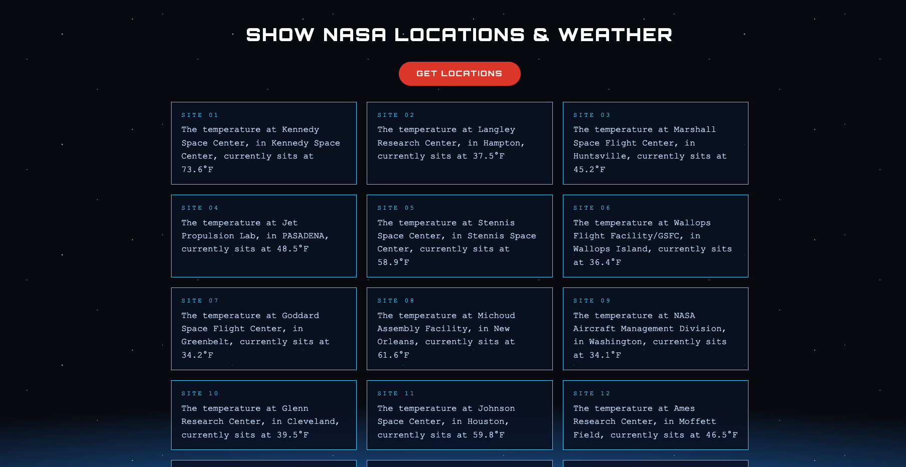

# 🚀 NASA Locations & Weather

A small web app that lists NASA facilities and shows the current temperature at each one. Click **Get Locations** and a panel appears for every site, numbered like a mission-control screen. It has a space theme, with a starfield background and a glowing Earth horizon.

[Visit NASA Facilities](https://1nasafacility.netlify.app/)

## Project Preview

## 🛠️ Built with

- **HTML5**: a title, a button and an empty section that the results are added to
- **CSS3**: CSS Grid, CSS counters for the site numbers, and a layered-gradient starfield (Google Fonts: Orbitron)
- **Vanilla JavaScript**: a click event listener, `fetch`, promises, `JSON.parse`, `map` and DOM creation
- **APIs**: one for the list of NASA facilities and one for current weather

## 📚 What I learned

- Chaining one `fetch` request into another
- Converting a JSON string into usable data with `JSON.parse`
- Looping over an array with `map` to make one request per item
- Creating elements with `createElement` and adding them with `appendChild`
- Numbering items automatically with CSS counters, and laying out cards with CSS Grid
